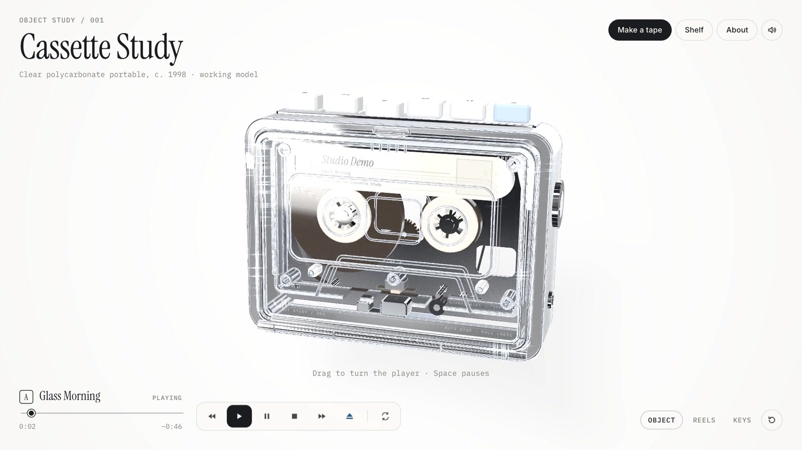

# Cassette Study

**Object Study / 001** — a transparent late-1990s portable cassette player you can actually use.
Open the door, load the tape, press play and watch the reels turn at the speed the music is really
moving. Wind it, turn it over, or make your own tape from two recordings and keep it on the shelf.

**Live:** <https://cassette-study-six.vercel.app>

**Demo films:** [v1.0.0 release](https://github.com/Mariaareadne1/cassette-study/releases/tag/v1.0.0) — portrait
1080×1920 and landscape 1920×1080, 28 s each, captured from the real app. Contact sheet: [demo/contact-sheet.png](demo/contact-sheet.png).



> The glass rendering is adapted from **Ann Nguyen**'s
> [CD case](https://www.bubbbly.com/cd-case) ([source](https://github.com/annnguyentt/vibe-coding/tree/main/cd-case)),
> made with [TypingMind](https://www.typingmind.com). See [docs/ATTRIBUTION.md](docs/ATTRIBUTION.md).

## What it does

- **A working mechanism.** Six latching keys (stop, rewind, play, fast-forward, pause, eject), a hinged
  door, spindles, flywheel, capstan, head and pinch roller that engage when you press play.
- **Reels that tell the truth.** One physical tape: pack radii conserve area, each hub turns at `v/R`,
  fast-forward accelerates as the take-up pack grows, and side B is the same tape run the other way.
  While music plays, the audio clock drives the tape.
- **Real sound.** Two original demo recordings, plus quiet synthesised mechanical sound — key clicks,
  latches, the door, the motor — with separate music and mechanism levels.
- **Make a tape.** Add MP3/WAV/M4A recordings to side A and B, name the sides, choose a label stock,
  layout and artwork; the 3D labels update as you type. Tapes are stored in your browser (IndexedDB)
  and never uploaded. Export a tape as a `.cassette` file, import it elsewhere, or save a collector card.
- **Handles you, too.** Drag the object to turn it; drag the cassette into the deck or just tap it.
  Every control has an accessible equivalent and a keyboard shortcut. Reduced motion is respected.

| Key | | Key | |
| --- | --- | --- | --- |
| Space | play / pause | E | eject / open the door |
| S | stop | L | load or take out the tape |
| ← / → | rewind / fast-forward | F | turn the tape over |
| Shift + ← / → | skip 10 s | M | mute |
| 1 · 2 · 3 | object · reels · keys | R | reset view |

## Run it

```bash
npm install
```

```bash
npm run dev
```

Open <http://localhost:5560>. To play your own music locally, put `side-a.m4a`, `side-b.m4a` and a
`tape.json` in `public/local/` — in development that tape loads instead of the demo. The folder is
git- and deploy-ignored, so it never leaves your machine. Production: `npm run build && npm start` (port 4560).

| Script | |
| --- | --- |
| `npm test` | 56 unit tests (transport, state machine, shelf, archive, soundtrack) |
| `npm run test:e2e` | 9 Playwright tests in GPU Chrome |
| `npm run typecheck` · `npm run lint` | |
| `npm run audio:demo` | regenerate the demo recordings |
| `node scripts/shoot.mjs` | visual QA stills |
| `node scripts/film.mjs --variant=landscape` | deterministic demo film (also `portrait`) |

## How it's built

Next.js (pages router) + React for the interface; plain Three.js for the object, with the CD case's
studio cube map, ray-traced refraction rods and framebuffer sequence generalised to three nested glass
groups. A pure, time-stepped state machine owns the door, cassette and transport; audio feeds it, the
stage and the interface only read it. See [docs/ARCHITECTURE.md](docs/ARCHITECTURE.md),
[docs/TESTING.md](docs/TESTING.md), [docs/CASE_STUDY.md](docs/CASE_STUDY.md) and
[docs/SOURCE_AUDIT.md](docs/SOURCE_AUDIT.md).

## Demo films

`scripts/film.mjs` drives the real app on a virtual clock, one frame at a time, calling the same
controller methods a click would. The soundtrack is **re-rendered offline** from the logged events with
the same recordings and the same sound-synthesis code — it is not a recording of the speakers. Films are
H.264 / yuv420p / AAC, published as release assets rather than committed.

## Privacy

No analytics, no accounts, no network calls besides loading the app. Audio you add stays in this
browser's IndexedDB until you delete it.

## Credits and licence

Rendering adapted from Ann Nguyen's CD case, made with TypingMind — credit as the author asks. The
secondary reference, iverene's *The Cassette Player*, was studied only; nothing was copied. Demo music
and all lettering are original. No manufacturer marks are used.

The adapted files are not covered by an open-source licence (the source has none), so **no licence is
granted for this repository yet**; please ask before reusing it, and credit Ann Nguyen for the rendering.
