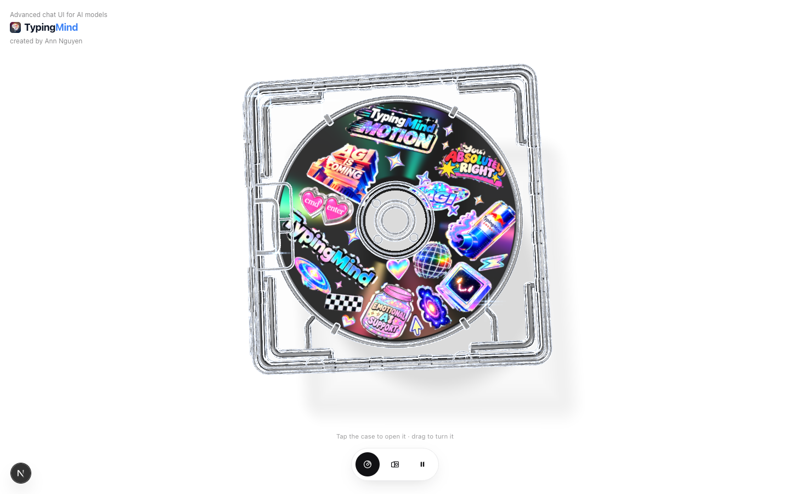

# Source audit

Audited on 2026-11-23 before any Cassette Study code was written.

| Reference | Commit | Role |
| --- | --- | --- |
| [annnguyentt/vibe-coding](https://github.com/annnguyentt/vibe-coding) `cd-case/` by **Ann Nguyen** ([@ann_nnng](https://x.com/ann_nnng)) | `faca2f6` (2026-10-12) | Primary — rendering foundation |
| [iverene/the-cassette-player](https://github.com/iverene/the-cassette-player) | `c176e4f` (2026-07-29) | Secondary — studied only, nothing copied |

Both were cloned to `~/Development/_refs/` (outside this repository) and were never modified.

## 1. CD Case (primary)

### Stack

Next.js 15 (pages router), React 19.1, `three@0.185.1`, plain JavaScript, no React Three Fiber, no
postprocessing library, no external assets except one 428 KB disc-print WebP. About 75 KB of source in
four files. `npm install && npx next dev` ran first time; it renders at 60 fps in headless Chrome
(`--use-angle=metal`) with no console errors. Baseline captures: `docs/media/reference/`.

### How the rendering really works

1. **Studio as a function, baked once.** `shaders.js → STUDIO` describes a room analytically: softbox
   bars, dark flags (`flags()`), hot strips (`hot()`), four tiny high-energy lamps, and a lit backdrop
   disc behind the object. `ROOM_BAKE_FRAG` supersamples (4×4) it into a 512² HDR cube map with mipmaps.
   The cube **alpha channel stores lamp energy**, which later drives the sparkle.
2. **Lighting is camera-relative.** Every shader works in view space (`vP`, `vN` are model-view), and the
   cube map is sampled with view-space directions. The object turns; the studio does not. This is why the
   case looks well lit from every angle — the reflection cards stay where the photographer put them.
3. **Rods are ray-traced analytically.** `caseGeometry.js → RodBuilder` sweeps a rounded-rectangle
   profile along 2D paths (in millimetres) and stores, per vertex, the rod's centre line (`aCentre`), its
   side axis (`aSide`) and profile size (`aSize = half-width, half-height, corner radius`). `ROD_FRAG`
   refracts the eye ray into the rod, solves the exit point against the rounded profile
   (`exitProfile`), and bounces up to 4 times with Fresnel weighting and Beer–Lambert absorption
   (`uAbsorb`), with 1–4 sub-pixel samples. Thin panels use a much cheaper `SHEET_FRAG` with
   premultiplied blending.
4. **Refraction needs a strict framebuffer sequence.**
   - Opaque scene (backdrop with analytic shadows, the disc) → `rtPage` (no depth buffer).
   - Glass is split into groups (tray, lid), **sorted back-to-front** by view depth each frame.
   - Each group renders into one of two MSAA ping-pong targets: a full-screen copy of the previous image
     first (`renderOrder −10`), then a **depth-only proxy of the opaque disc** (`renderOrder −5`) so
     glass behind it is rejected, then rods (which sample the previous image as `uBehind`, offset along
     the refracted ray by `uDepth`) and sheets.
   - Everything happens inside a scissor rectangle around the projected case.
   - **Alpha is a data channel:** backdrop writes 0, opaque matter writes ≥1 (refraction shows only 25%
     of the backdrop through glass, `PAGE_SHOW`, but 100% of matter), and values above 2 mark sparkle.
5. **Post.** `BRIGHT_FRAG` finds local maxima of `alpha − 2`, `STREAK_FRAG` smears them horizontally
   and vertically into four-point stars, `FINAL_FRAG` composites and does the sRGB conversion
   manually (the renderer runs linear, `autoClear = false`).
6. **Shadows** are analytic: `BACKDROP_FRAG` intersects light rays with planes in the tray and lid local
   frames and evaluates rounded-box / ring SDFs with distance-dependent softness. No shadow maps.
7. **Motion.** Open/close are hand-keyed curves through monotone cubic Hermite splines (`curve()`),
   blended with an idle sway. Drag turns the case with a damped spring back to rest (k = 16, c = 5.5);
   a tap under 6 px opens it. Adaptive DPR probes frame gaps and steps the pixel ratio down.

### Reuse plan

| Part | Decision |
| --- | --- |
| `STUDIO`, `ROOM_BAKE_FRAG`, `fresnel` | **Reuse almost verbatim**; backdrop tint warmed very slightly |
| `ROD_VERT` / `ROD_FRAG` / `OUTSIDE` | **Reuse verbatim** — the heart of the look; adds a tint uniform |
| `SHEET_*` | Reuse, with a tint uniform |
| `RodBuilder`, `profile`, `fillet`, `sheet`, `mergeSheets` | **Port to TypeScript** unchanged in behaviour |
| Ping-pong group pipeline, depth proxies, scissor, alpha conventions | **Reuse the design**, generalised from 2 fixed groups to N sortable groups with a forced order when the tape is seated |
| Bright/streak/final post | Reuse, with gentler star strength |
| `BACKDROP_FRAG` | **Rewrite**: rounded-box shadows for the player body, door and loose tape |
| `curve()` monotone spline | Reuse for keyed mechanical motion (eject kick, button travel) |
| Disc geometry/shader, jewel-case geometry, auto open/close show | Not used — replaced by a cassette player |
| Brushed metal, tape pack, printed label, decal-on-glass shaders | **New** — written against the same studio |
| Mechanics, transport, audio, persistence, UI | **New** |

### Licence and attribution

There is **no LICENSE file**. The collection README says: *"If you use, remix, fork, or learn from
anything in this repo, please give credit"* to Ann Nguyen and TypingMind, and *"a mention or a link back
is enough."* We read that as permission to remix with credit, not as a general open-source licence, so:
credit is in `README.md`, `docs/ATTRIBUTION.md` and the in-app Credits panel; the adapted shader and
geometry files carry a header naming the source; the TypingMind badge, the disc print
(`stickers.webp`) and all reference branding are **not** copied. Dependencies (three.js, Next.js,
React) are MIT.

## 2. The Cassette Player (secondary)

Next.js App Router + React Three Fiber + drei + postprocessing + GSAP + Zustand + Tailwind, a dark room
with a CRT TV playing video. **No licence file and no permission statement**, so nothing was copied; it
was read for ideas only. Findings:

- Playback state is one Zustand enum (`idle | starting | playing | paused | rewinding |
  fast-forwarding | stopping | ended`) — a useful checklist of modes.
- The reels are **constant-speed** (`rotation.z += delta * speed * direction`) and unrelated to
  position — exactly the behaviour this project must not have.
- No cassette insertion, door, two sides or persistence.

Cassette Study's transport is therefore designed from first principles (see `docs/ARCHITECTURE.md`).
